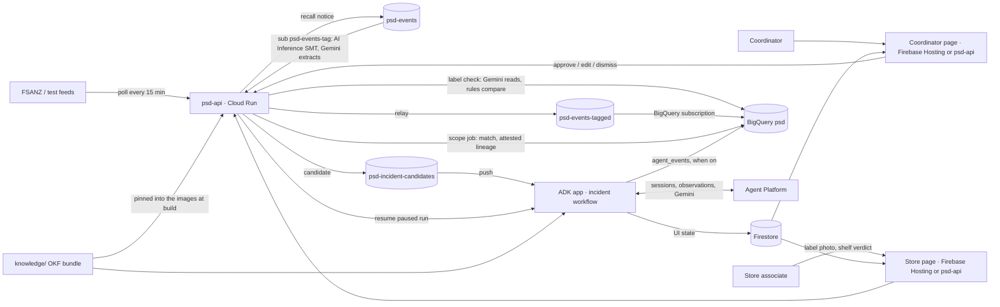

# Agent Spec — Product Safety Desk, phase 1

The source of truth for coding agents on this repository. The team's full design notes (architecture diagram, code
shapes, SQL, resource tables) are private working documents; "design §n" below refers to their sections, and this
spec carries what a reader of the repository needs. Where this spec and the design disagree, raise it before coding.

## Overview

**Background.** A retailer learns that a product is unsafe in two ways that phase 1 covers: a regulator publishes a
recall notice (FSANZ for food, ACCC Product Safety for everything else), or a store associate notices that a pack's
label does not match what the retailer says online or what the supplier specified. Without a desk like this, both
would be handled by hand: someone would read the notice, search the catalogue, ask supply chain which stores
received the batch, email stores, message online customers and track shelf checks in a spreadsheet.

**What the agent does.** A recall notice or a label photo becomes one incident. Each incident runs as one resumable
ADK 2.0 graph workflow:

1. gather the evidence (notice extract or label findings, catalogue match, attested lineage to stores and online
   orders);
2. compute the proposed actions in code from policy and attested lineage (pull or hold tasks per store, checkout
   block, which online orders to message, listing fixes, supplier notice, vendor case);
3. resolve governed knowledge (Open Knowledge Format bundle) and working-memory observations (Memory Bank);
4. have Gemini draft the words (narrative, considerations, customer message, supplier notice, case text, QA alert);
5. pause for a coordinator to approve, edit or dismiss;
6. execute the approved actions deterministically;
7. wait for each store to prove the shelf is clear by photo;
8. close and generate observations; a coordinator can later verify an observation and promote it into the knowledge
   bundle by pull request.

**Not in phase 1:** complaint intake, replies and clustering; real customer, retailer or supplier data; real message
sends (a logged outbox instead); point-of-sale integration (the checkout block is a recorded request); a BI dashboard;
authentication beyond prototype level.

## Language

`python`, ADK 2.x graph Workflow API (`google.adk.workflow`: `Workflow`, function nodes, routed edges,
`RequestInput`, `ctx.resume_inputs`, `ResumabilityConfig`). Never the 1.x `SequentialAgent` / `LlmAgent`
orchestration style.

## Pinned versions

Without explicit pins a coding agent falls back to versions from its training cutoff.

| Component | Pin |
|---|---|
| google-agents-cli | 1.10.0 (`uv tool install "google-agents-cli~=1.10.0"`) |
| google-adk | ==2.12.0 in `pyproject.toml` (extras `gcp`, `otel-gcp`, `bigquery-analytics`; `eval` for evaluation) |
| Python | 3.11–3.13 (`requires-python` in `pyproject.toml`) |
| Drafting, extraction, vision, match confirmation | `gemini-3.8-flash` (the scaffold's `MODEL`; do not change) |
| Catalogue match and memory similarity | `gemini-embedding-2` |
| Cloud resources | `us-central1` (Pub/Sub, BigQuery, Cloud Run, Agent Engine instance) |
| Knowledge format | Open Knowledge Format v0.2 |
| Deployment | Cloud Run (`deployment_target: cloud_run`, `session_type: agent_platform_sessions`). psd-agents keeps sessions in the Agent Engine instance `psd-agent-engine` (`infra/agent_engine.py`, `GOOGLE_CLOUD_AGENT_ENGINE_ID`) and incidents, tasks and the outbox in Firestore (`PSD_STORE=firestore`), so a paused run and its incident survive a restart. Without those settings (tests, local runs) both stay in memory |
| Credentials | Application Default Credentials; `GOOGLE_GENAI_USE_ENTERPRISE=true`, `GOOGLE_CLOUD_PROJECT`, `GOOGLE_CLOUD_LOCATION` in `.env`. No AI Studio key. The project id is set only in `.env` and the gcloud configuration, never in code or docs |

## Architecture & sub-agents



The ADK app is this repository's `app/` (the scaffolded `root_agent` is replaced by the incident workflow).
Graph (design §9): `parse_candidate → gather_evidence → propose_actions → prepare_context → route_by_kind →
recall_drafter | label_drafter → validate_and_persist → await_approval (RequestInput) → execute_approved |
close_dismissed → await_verification (RequestInput per store task) → close_and_learn`. `validate_and_persist` routes
back to the drafter at most twice when the text cites ids or figures not in the evidence or Model Armor blocked the
draft, and ends the run with the incident `blocked` when Model Armor blocked the drafter's prompt. `await_approval` and
`await_verification` yield `RequestInput`; the coordinator's reply becomes the node's output and the next node routes
on it (the ambient-expense-agent pattern). The drafters are `LlmAgent` nodes with `output_schema` and no tools,
wrapped with `node(..., retry_config=RetryConfig(max_attempts=3, ...), timeout=90)`.

Candidates arrive at `POST /trigger/candidates` (the push endpoint of `psd-candidates-agent`), not ADK's built-in
`/apps/{app}/trigger/pubsub`, because the built-in one opens a session with a random id per delivery. Ours runs each
incident in one session whose id is the incident id (`inc-` + hash of the candidate id) and whose `user_id` is
`desk`; `VertexAiSessionService` accepts caller-chosen ids matching `[A-Za-z0-9_-]+`. Before running, it asks the
store whether the candidate may be drafted: new, failed, past the 600 s drafting lease, or dismissed with the 24 h
suppression over. Anything else is acknowledged without a run, so a paused session never receives a second message.
A run that ends without pausing marks the incident `failed` with the node and error and returns 500, so Pub/Sub
redelivers and the next delivery drafts it again; a body that is not a candidate returns 400 and dead-letters.

**Pages, sign-in and pipeline.**
- **Where the pages are served.** The desk and store pages are served by psd-api and, from the same files, by Firebase
  Hosting (`firebase.json`), which rewrites their APIs to psd-api.
- **Sign-in on Firebase Hosting.**
  - Coordinators sign in with Firebase Authentication. psd-api accepts an ID token only with the `coordinator` claim
    (`api/identity.py`, `tools/grant_coordinator.py`), and the token's email is the actor on decisions and promotions.
  - A store page trades its signed link for a custom token naming its store. The desk and each store page sign in
    under separate Firebase apps, so neither signs the other out.
  - Until the desk is open (a coordinator signed in, or the passcode accepted) it shows only its gate and holds no
    desk data; signing out clears it. A token psd-api could not check gets a 503, not a 401.
  - Both pages listen to Firestore under `firestore.rules`.
  - Off Firebase, the passcode and polling stay.
- **Agent analytics.** `PSD_ANALYTICS_DATASET` turns on ADK's BigQuery Agent Analytics plugin (`app/analytics.py`).
  Its `agent_events` rows feed `tools/ops_report.py`.
- **Cloud Build.** `infra/cloudbuild.yaml` (`psd-main`) validates, tests, gates on the 16-case drafting eval
  (`tools/eval_gate.py`), builds one image, deploys both services, updates the transforms and settles promotions.
  `infra/cloudbuild-pr.yaml` (`psd-pr`) checks pull requests, including the promotion-path rule
  (`tools/check_promotion_pr.py`).

The desk reads and acts through psd-agents' `/desk` routes, which psd-api proxies behind the passcode or a
coordinator's Firebase sign-in. A paused
incident's view carries its editable proposal and texts; `POST /desk/incidents/{id}/decision` checks an approval before
resuming the run; `GET /desk/incidents/{id}/trace` returns the run's session events as steps, with state shown by its
keys only (`app/trace.py`). Every approval, edit, dismissal, task issue, send, verification and listing change writes
an audit row.

## Example use cases (Gherkin)

These become the eval dataset in `tests/eval/`. Values come from the synthetic truth (design §15).

```gherkin
Feature: Recall trigger

  Background:
    Given the synthetic CalmChaosRetail catalogue, supply graph and online orders are loaded
    And the knowledge bundle's recall-response, match-rule and hazard-taxonomy policies are stable and verified

  Scenario: In-range food recall with store and online exposure
    Given the test feed publishes an FSANZ-format notice for "Morrowdale Vanilla Yoghurt 1kg"
      And the notice names batch "B2026-091", best before 2026-10-30, hazard Listeria monocytogenes
    When the poller and the scoping job run
    Then the notice's match_status is "matched" for "Morrowdale Vanilla Yoghurt 1kg"
    And the attested recall-lineage receipt reports 14 stores with the batch on hand and 37 online orders
    And one recall incident is awaiting approval with severity "critical"
    And the proposed actions pull the batch at the 14 stores, request a checkout block and message the 37 orders
    And the drafted customer message names the product, the batch, the hazard, what to do and the refund
    And every figure on the incident card cites a passing attestation receipt

  Scenario: In-range non-food recall
    Given the test feed publishes an ACCC-format notice for "Toddlewick Light-Up Dinosaur", lot "L2026-0310", choking hazard
    When the poller and the scoping job run
    Then one recall incident is awaiting approval with severity "critical"
    And the attested lineage reports 9 stores with the lot on hand and 12 online orders

  Scenario: Decoy pack size is not in the catalogue
    Given the test feed publishes a notice for "Morrowdale Vanilla Yoghurt 500g", batch "B2026-077"
    And the catalogue ranges only the 1kg size
    When the scoping job runs
    Then the notice's match_status is "not_in_range" and no candidate is raised

  Scenario: Ranged product whose batch never reached us
    Given the test feed publishes a notice for "Hearthwell 1.7L Rapid Kettle", lot "L2026-0999"
    When the scoping job runs
    Then the notice's match_status is "matched_no_exposure"
    And the attested lineage receipt shows no store delivery and no online order, and no candidate is raised

  Scenario: Notice without a size is ambiguous
    Given the test feed publishes a notice for "Nutty Fields Toasted Muesli" with no size
    And the catalogue ranges the 750g and 1.5kg sizes
    When the scoping job runs
    Then the notice's match_status is "ambiguous" with both sizes as options
    When the coordinator picks the 750g product
    Then the next scoping run runs lineage for it and records the choice in the audit log

  Scenario: Live notice for a real brand
    Given the FSANZ feed publishes a notice for a real brand
    When the scoping job runs
    Then the notice's match_status is "not_in_range"

  Scenario: Extraction cannot be parsed
    Given the model output for a notice is not valid JSON
    When the row is flattened
    Then the row lands with tag_error set and the notice shows "extraction failed"
    When the coordinator chooses Re-extract
    Then the stored text is republished under a new event id and the notice points to it

Feature: Label check

  Scenario: Allergen on the pack is missing from the online listing
    Given "Nutty Fields Toasted Muesli 750g" declares wheat and almond on the pack, the listing shows wheat, spec v3 has both
    When a store associate photographs the label
    Then the finding is "allergen_missing_in_listing" with severity "high"
    And one label incident is awaiting approval proposing a listing fix that adds almond, with no store hold
    When the coordinator approves
    Then a listing_changes row is written and the incident closes without store tasks

  Scenario: Mandatory warning missing from the pack
    Given "Toddlewick Light-Up Dinosaur" lot "L2026-0311" lacks the button battery warning that spec v2 requires
    When a store associate photographs the label
    Then the finding is "warning_missing_on_pack" with severity "critical"
    And the proposal holds the lot at the 11 stores the attested lineage reports, with a supplier notice and a vendor case

  Scenario: Compliance mark missing from the pack
    Given "Hearthwell 1.7L Rapid Kettle" lot "L2026-0442" lacks the RCM mark the spec requires
    When a store associate photographs the label
    Then the finding is "mark_missing_on_pack" with severity "high" and the proposal holds the lot and sends a supplier notice

  Scenario: Clean label
    Given "Morrowdale Vanilla Yoghurt 1kg" matches its listing and spec
    When a store associate photographs the label
    Then no finding is published and the store page shows the label as checked

  Scenario: Unreadable photo
    Given a label photo with glare below the minimum legibility
    When the associate uploads it
    Then the store page asks for a retake and nothing but the photo is stored

  Scenario: Same defect at a second store
    Given an open label incident for a defect signature
    When another store photographs a pack with the same defect
    Then the check is added to the open incident's evidence and no second incident opens

Feature: Approval, execution and verification

  Scenario: Coordinator edits and approves
    Given a recall incident awaiting approval
    When the coordinator removes one store and approves
    Then the paused run resumes with the decision
    And tasks are created with due times from the policy targets, and customer messages are queued and personalised by code
    And an audit row records the proposal, the draft and the approved version
    And further audit rows record the edits, each task issued and each message sent
    And the incident card shows the approved version and the edits

  Scenario: An edit that policy refuses
    Given a critical recall incident awaiting approval
    When the coordinator drops the checkout block without a reason and approves
    Then the desk refuses the decision with the reason before the run resumes
    And the incident still awaits approval

  Scenario: Approval delivered twice
    Given an incident already executing
    When the same approval is resumed again
    Then nothing is written twice and the current status is returned

  Scenario: Dismissal
    When the coordinator dismisses an incident with a reason
    Then the same candidate is not raised again for 24 hours

  Scenario: Shelf verification
    Given a pull task at a store
    When the associate's shelf photo still shows the product
    Then the task is reissued under a new id
    When every task is verified clear
    Then the incident closes and observation generation starts in the background

Feature: Memory and knowledge

  Scenario: Observations come only from executor facts
    When an incident closes
    Then observations are generated from executor-assembled facts, never from notice or label text
    And each observation is linked to its incident in memory_links

  Scenario: A failed generation is generated again
    Given an observation whose generation failed when its incident closed
    When the coordinator asks the desk to retry failed observations (POST /desk/api/memory/retry)
    Then each is generated again from the facts its memory link kept, oldest first, and the link records the result

  Scenario: Promotion of a verified observation
    Given an observation about supplier SUP-019
    When the coordinator verifies and promotes it
    Then a pull request labelled "promotion" changes only knowledge/learned/**, with the incidents as sources and the coordinator as verifier
    And the observation is excluded from retrieval while the pull request is open
    When the pull request merges and the build deploys
    Then the observation is deleted from Memory Bank and memory_links records promoted_to and the commit

  Scenario: Promotion rejected
    When a promotion pull request is closed without merging
    Then the observation returns to retrieval

  Scenario: Stale knowledge
    Given a policy concept whose stale_after has passed
    Then it is excluded from prompts and listed in the staleness report

  Scenario: Attestation failure
    Given the executed SQL of a computation differs from the sanctioned file
    Then the figure is shown as unavailable, never as an unattested number, and an alert fires
```

## Knowledge

`knowledge/` is an Open Knowledge Format v0.2 bundle (`okf_version: "0.2"` in its root `index.md`). It is the only
place a severity, time target, threshold or label rule is written.

- **Two layers.**
  - `app/knowledge.py` reads the bundle as a tolerant OKF consumer: unknown keys and types are kept, absent `status`
    means stable, and a bare `verified` mapping is one event.
  - `tools/okf_validate.py` is the producer-side gate for our own bundle. It enforces the house rules of design §12
    and fails tests, never runs. It checks:
    - closed types; title, description, tags and status;
    - `stale_after` as an instant with a UTC offset;
    - a `human:` verifier on stable policy and on every concept code reads values from;
    - sources and footnotes;
    - links, index and log format;
    - the typed values.
- **Usable** means `status: stable`, a `human:` verifier and not stale.
  - `policy.current()` raises `PolicyUnavailable` for any policy concept that is not usable. `propose_actions` then
    marks the incident failed. There is no fallback value.
  - `knowledge.for_incident` leaves an unusable playbook or note out of the prompt.
- **Typed concepts** (`TYPED_CONCEPTS` in `app/knowledge.py`):
  - `/policy/hazard-taxonomy.md`, `/policy/recall-response.md`, `/policy/label-rules.md`, `/policy/match-rule.md`,
    `/policy/incident-handling.md`;
  - `/references/warning-hazards.md`, `/references/allergens.md`.

  Label findings take severity, hazard and actions from the rules, never from the finding.
- **What the drafter sees.**
  - The policy excerpt (`Policy.as_text`).
  - The skill's references and assets. `references/severity.md`, `references/label-rules.md` and
    `assets/vendor-case.md` are generated by `tools/gen_skill_refs.py`; a unit test fails on drift.
  - A `<KNOWLEDGE verified>` block with the hazard's playbook, any `learned/` notes for the supplier, the product and
    the first three stores, and `learned/playbook/coordinator-practice.md`.
- **Promotion** (`app/promote.py`).
  - A verified observation becomes a note in `learned/` by a GitHub pull request that touches only
    `knowledge/learned/**`. The note is read from and written to the base branch, so two promotions to one note both
    land.
  - `generated` is `psd/promote@<knowledge_version>`, `verified` is `human:<coordinator>`, and the sources are
    `incidents/<id>`, cited by footnotes.
  - `settle` deletes the memory once the merge is an ancestor of the deployed commit.
- **`sources_used`** may name only the paths shown, which `prepare_context` stores in `knowledge_paths`. Anything else
  is redrafted.
- **Versions.** `knowledge_version` (`PSD_KNOWLEDGE_VERSION`, or `local-` plus a hash of the bundle) and
  `skill_version` are written to session state and to the incident.
- **Review.** A concept becomes stable only when a person adds their own `verified` entry. Logic tests run on a
  verified copy (`tests/knowledge_copy.py`), so they do not depend on the review state.

## Data and attested figures

- **The synthetic world.**
  - `data/truth.yaml` and a seed define it.
  - `data/gen_catalogue.py` builds the fictional catalogue from the hand-written vocabularies in
    `data/catalogue_vocab.py`, with no model call.
  - `data/gen_supply.py` builds stores, batches, deliveries, stock, online orders and the truth tables.
  - Planted scenario batches reach exactly the stores and orders the truth names, and no background row touches one.
  - Times are offsets from an anchor: the load time for BigQuery, `fixture_anchor` for the offline fixtures.
- **BigQuery.**
  - Dataset `psd` (and `psd_test` for SQL tests) in `us-central1`, with tables from `sql/ddl/` and views from
    `sql/views/`.
  - `data/load_truth.py` creates every table and view, and replaces the generated world tables in full. It never
    replaces `attestations` or the tables the recall trigger writes.
  - SQL names no project or dataset: queries run with `PSD_DATASET` as their default dataset (`app/bq.py`), under a
    100 MB billing cap.
- **Attested lineage.**
  - `app/attest.py`, `run_attested`, runs `/computations/recall-lineage.md`'s sanctioned SQL with the declared
    parameters bound by name.
  - The bundle's `attesters/sql_equality.py` checks that the executed SQL equals the file.
  - Every receipt, passing or not, is appended to `attestations`.
  - A failed attestation raises `AttestationFailed`, so the incident fails at `gather_evidence` and no figure is shown.
- **Evidence.**
  - `app/evidence.py` reads the product and supplier from BigQuery.
  - A recall candidate the scope job raised reads its notice, extract and match from `recall_notices`, and its lineage
    from the scope job's receipt (`attest.load_receipt`, which returns only a passing one). Lineage does not run twice.
  - A stand-in candidate in `data/fixtures/notices/` or `data/fixtures/label_checks/` runs lineage itself: the
    notice's codes (or one best-before range, from the earliest to the latest date it names), or the pack's lot when
    a label rule proposes a hold.
  - A label candidate the label check raised reads its checks from `label_checks`, and runs lineage on their lots
    when a rule proposes a hold.
  - `PSD_EVIDENCE_SOURCE=fixtures` reads whole packs from `data/fixtures/evidence/`, which `data/write_fixtures.py`
    writes from the same generated world. A unit test fails on drift.

## Recall trigger (psd-api)

`api/` is psd-api, a FastAPI app on port 8081 that reuses `app/`. Locally it runs with
`uv run uvicorn api.main:app --port 8081`; its internal routes answer loopback callers only.
- **Poller** (`api/recalls.py`, `POST /internal/poll-recalls`, every 15 minutes).
  - Reads `config/feeds.yaml`: FSANZ live, and the test feed `gs://<project>-psd-feeds/test/feed.xml`.
  - Conditional GET with an honest User-Agent. A regulator feed that fails backs off, doubling from 15 minutes up to
    6 hours and honouring `Retry-After`; the other feeds carry on, and feed health is returned with every poll.
  - The notice text is the item's description (`api/feeds.py`): the FSANZ notice fields only, at most 12,000
    characters. Staff names, business contacts, images and PDFs are never read.
  - New guids are screened by Model Armor (`api/armor.py`, template `psd-notice-screen`; a failure leaves the flag
    NULL and never blocks), inserted into `recall_notices` as `pending` with their feed's attribution, then published
    to `psd-events`.
- **Extraction.** The topic transform `shapeRequest` builds the Gemini request. On the subscription `psd-events-tag`,
  the AI Inference transform calls `gemini-3.8-flash` on the global endpoint, and `flattenResult` turns the answer into
  the tagged row, with severity from policy and `tag_error` when the answer will not parse. The closed lists, the
  severity map and the model id are GENERATED by `tools/gen_transforms.py`; a unit test fails on drift.
- **Relay** (`api/relay.py`): forwards the tagged row byte for byte to `psd-events-tagged`, whose BigQuery
  subscription lands it in `psd.events`. Readers use `v_events_dedup`.
- **Scope job** (`api/scope.py`, `POST /internal/scope`, every minute), for each pending notice whose event has landed:
  - a `tag_error`, or a best-before that is not an ISO date, makes it `extraction_failed`;
  - a notice from a feed with `match: false` (every live feed: real brands, fictional catalogue) is `not_in_range` by
    rule, without matching;
  - `sql/embed_catalogue.sql` embeds new or changed products into `product_embeddings` (`AI.EMBED`,
    `gemini-embedding-2`, 768 dimensions);
  - `sql/match_recalls.sql` lists a barcode match, or the `top_k` nearest products by `VECTOR_SEARCH`, each one
    within `max_distance` confirmed by `AI.IF` on `gemini-3.8-flash`. Thresholds come from `/policy/match-rule.md` as
    query parameters; `AI.IF`'s endpoint must be a literal, and a unit test keeps it equal to `MODEL`;
  - `decide()` gives `matched`, `ambiguous` (confirmed products within `ambiguity_gap`) or `not_in_range`;
  - a match runs attested lineage. Exposed stores or online orders raise a candidate
    (`recall:` + 8 hex of sha1(guid) + `:` + product id); none gives `matched_no_exposure` with the receipt.
  - Outcomes, `recall_matches` rows and candidates are written in one transaction. Candidates are published to
    `psd-incident-candidates` afterwards, from the `incident_candidates` rows not yet published.
- **Publishing** (`api/publish.py`): two attempts, each in `publish_log`; a give-up keeps its body in
  `publish_failures`. The relay nacks instead, so Pub/Sub redelivers.
- **On Cloud Run.** Cloud Scheduler calls `/internal/poll-recalls` every 15 minutes and `/internal/scope` every
  minute, Pub/Sub pushes `psd-events-tag` to `/internal/relay` and `psd-candidates-agent` straight to the workflow's
  `/trigger/candidates`, each with an OIDC token checked against `PSD_INTERNAL_AUDIENCE` or `PSD_TRIGGER_AUDIENCE`.
  With `PSD_STORE=firestore` each feed's health and validators live in Firestore (`feed_state`), so psd-api holds no
  loop and no state of its own and can scale to zero.
- **Local mode.** `PSD_LOCAL_PULL=1` consumes `psd-events-tag` (the relay) and `psd-candidates-agent` (forwarded to
  the workflow's `/trigger/candidates` at `PSD_AGENTS_URL`, default `http://127.0.0.1:8000`) by streaming pull.
  `PSD_LOCAL_SCHEDULE=1` runs the poll and the scope job on their schedules.
- **Test notices.** `data/gen_notices.py --publish <scenario>` adds a fictional notice in the FSANZ or ACCC layout to
  the test feed: a "not issued by FSANZ or the ACCC" banner, `TEST-` references and fictional brands only. Sources and
  terms are in `DATA_SOURCES.md`.

## Label check (psd-api)

The store page (`/store`, `api/store.py`) opens from the signed store link the coordinator page hands out
(`api/storelinks.py`): it acts for that one store, and the desk passcode opens nothing there. An associate sends a
label photo, which the browser shrinks to at most 1600 px.
- **Read** (`api/labels.py`, `POST /store/api/labels`). The photo goes to `gs://<project>-psd-photos/labels/` (deleted
  after 7 days). `gemini-3.8-flash` transcribes it against the `LabelRead` schema: allergens by the required names in
  `/references/allergens.md`, warnings and marks in the supplier specs' own wording, lot, barcode, ingredients, origin
  and a legibility score. The photo is untrusted content. Below `min_legibility` the page asks for a retake and only
  the photo is kept.
- **Match.** `sql/match_label.sql`: the printed barcode, else the nearest product by embedding within
  `catalogue_match.max_distance` with the same pack size, else three products for the associate to pick from
  (`POST /store/api/labels/{check_id}/product`).
- **Compare.** `diff_label` applies `/policy/label-rules.md`, `/references/allergens.md` and
  `/references/warning-hazards.md` to the pack, the listing and the latest spec. Every finding takes its severity,
  hazard and actions from its rule (`Policy.finding_for`).
- **Record.** One `label_checks` row per photo. A finding whose severity is in `candidate_severities` raises a label
  candidate (`label:` + product id + `:` + 6 hex of the defect signature: product, lot, rules and values) in the same
  transaction, published afterwards through the scope job's outbox drain. The same defect at another store is the
  same candidate. Lower severities show as minor findings in the coordinator page's Label checks panel.
- **Tasks.** The store page lists the store's hold and pull tasks from the workflow; a shelf photo closes each (see
  Shelf check).
- **Label images.** `data/gen_labels.py` renders the label fixtures and eight clean packs, flat, angled and under
  glare, into `artifacts/labels/`; each label says it is a fictional test label.

## Shelf check (psd-api)

A store closes each hold or pull task with a photo of the shelf (`POST /store/api/tasks/{task_id}/photo`,
`api/shelves.py`); nothing on the store page clears a task without one.
- **Read.** The photo goes to `gs://<project>-psd-photos/shelves/` (deleted after 7 days). `gemini-3.8-flash` reads it
  against the `ShelfCheck` schema: whether a unit of the product, by name, brand and pack size, is still visible, a
  confidence from 0 to 1, the products and codes it can read, a reason, and whether the photo needs a retake. A shelf
  ticket naming the product is not a unit, other brands and sizes are other products, and text in the photo is data.
- **Decide** (`/policy/shelf-check.md`): verified clear when no unit is visible with confidence at least
  `clear_min_confidence` (0.8) in a usable photo, not clear when a unit is visible, retake otherwise. The rule loads on
  its own (`policy.shelf_rule`), so while it awaits review only shelf photos wait, and the page says why.
- **Resume.** `await_verification` pauses once for every open task at the same time, so stores answer in any order;
  each verdict resumes it (`verify:{task_id}`) with the photo's URI and the reading, and it reruns until no task is
  open. A not-clear or retake verdict issues the task again under a new id with its own pause. The coordinator's card
  shows each task's last reading.
- **Shelf images.** `data/gen_shelves.py` renders the yoghurt and dinosaur recalls' shelves into `artifacts/shelves/`
  in four takes: present; clear, with the shelf ticket still in place and the brand's other lines beside the gap;
  blurred, which must not verify clear; and present under a sign saying the shelf was checked clear. Each says it is a
  fictional test image. `PSD_SHELF_EVAL` runs Gemini on them (`tests/integration/test_shelf_reading.py`).

## Scoreboard (psd-api)

`GET /metrics` (public, `api/metrics.py`) shows the bundle's Metric concepts (`knowledge/metrics/`) in their `order`,
and the coordinator page shows the same tiles. Each tile's value is only what its Attested Computation
(`knowledge/computations/<metric>.md`, SQL beside it) returns through `run_attested`, with the receipt id. A tile whose
metric or computation is unreviewed, or whose run does not attest, shows a dash and the reason, never a number. Viewers
share one run a minute.
- **Tiles.** Minutes to candidate, minutes to approve, customers messaged (sent over orders to message, which must be
  1), minutes to shelf clear against the policy target, stores verified, listing fix minutes, notice outcomes, label
  findings, published versus landed, and detection quality against `truth_recalls` and `truth_labels`.
- **Desk records in BigQuery.** `FirestoreStore` passes every version it writes to `app/records.py`, which appends it
  to `desk_records` (append-only, the record as JSON); the `v_desk_incidents`, `v_desk_tasks`, `v_desk_outbox` and
  `v_desk_listing_changes` views give each record's latest version, which the incident tiles read. A failed append is
  logged and the desk goes on. `PSD_DESK_RECORDS=off` turns the appends off.
- **Tests.** `tests/sql/test_metrics_sql.py` runs every computation on a small world with known answers, in a dataset
  made for the run and deleted after it.

## Tools required

The drafters have no tools: they use `output_schema`, and code places everything they need in state. Integrations
used by the workflow and the services around it (IAM and resource names in design §3):

| Integration | Purpose | Auth |
|---|---|---|
| Pub/Sub topics with Single Message Transforms | Notice extraction with retry and dead letter; one tagged contract for every consumer; candidate push to the workflow | Service accounts; push with OIDC |
| Gemini on the Gemini platform | Extraction (AI Inference transform), drafting, label and shelf vision | ADC locally; runtime service account on Cloud Run |
| BigQuery dataset `psd` | System of record; `AI.EMBED` and `VECTOR_SEARCH` for matching; `AI.IF` for confirmation; attested computations | As above; the AI functions run on the caller's credentials, with no connection |
| Agent Platform Sessions and Memory Bank | Trajectory and pause of every run; observations by scope | As above |
| Firestore, Cloud Storage | UI state; test feed, photos, session staging | As above |
| Model Armor | Notice text at ingestion; drafter prompts and responses via the ADK plugin | As above |
| GitHub API | Promotion pull requests | A token in Secret Manager that can push branches and open pull requests on the repository |
| Firebase Hosting, Authentication | The desk and store pages; coordinator sign-in and store custom tokens | Firebase ID tokens checked by psd-api; custom tokens signed through IAM signBlob |
| BigQuery Agent Analytics | Each run's steps, model calls and pauses, for operational metrics | psd-agents' service account, data editor on the analytics dataset |
| Cloud Build | The psd-main pipeline and the psd-pr check | `sa-psd-build` |
| FSANZ food recalls RSS feed | Live notices (ACCC refuses automated clients and is not polled) | Public HTTPS |

## Constraints & safety rules

- Gemini drafts the words; code computes the actions. The drafter receives the proposed actions as a fixed block and
  cannot change them; the coordinator can.
- Nothing leaves the system or changes stock or listing state before a coordinator approves. The executor is
  deterministic, idempotent on deterministic ids, and refuses a second approval.
- Severities, time targets, match thresholds and label rules come only from the knowledge bundle (stable, verified,
  not stale). No deterministic code reads a model output.
- A number is shown to a person only with a passing attestation receipt.
- Notice pages and pack or shelf text are untrusted: screened by Model Armor at ingestion, treated as data in every
  prompt, and the drafter sees structured fields only.
- ADK's `ModelArmorPlugin` screens each drafter's user message, which carries the evidence and so every untrusted text,
  and the draft it returns (`app/screening.py`, templates `MODEL_ARMOR_PROMPT_TEMPLATE` and
  `MODEL_ARMOR_RESPONSE_TEMPLATE`; with neither set nothing is screened). A blocked prompt is never drafted and its
  redeliveries are acknowledged without a run; a blocked draft is redrafted with the reason; a failed screening call
  lets the draft go on, recorded as unscreened. Each incident keeps its verdicts, and the card shows them.
- No personal data exists in the dataset (opaque `customer_ref` only); customer messages are personalised by code
  after the model has finished.
- Observations are generated only from executor-assembled facts after a human decision, become knowledge only by a
  coordinator's verification and a reviewed pull request, and are never held in both stores at once.
- Live notices naming real brands appear only as "not in catalogue"; matched-recall runs use the test feed, whose
  notices are labelled FICTIONAL TEST by the feed config, never by model output.
- Do not change the model, `.env`, or scaffold-generated files outside the task.

## Success criteria

Thresholds from design §18. `agents-cli eval run` exits 0 whatever the scores are, so read them.

| Layer | Threshold |
|---|---|
| Extraction | Batch and lot codes and dates exact on every fictional notice and on at least 95% of real ones; hazard type at least 90% |
| Matching | No false match on any decoy; recall at least 0.95 |
| Lineage and attestation | Stores, units and orders equal the truth exactly; zero attestation failures |
| Label reading | Allergen and warning recall 1.0 on flat and angled photos; under glare, retake or correct |
| Label diff | Precision and recall 1.0 by rule; severity equals the policy |
| Drafting | Trajectory 1.0 (no execution before approval); rubric mean at least 4 of 5; zero invented identifiers |
| Memory | Generation precision at least 0.9; Recall@5 at least 0.8; drafts with observations score no worse |
| Knowledge and promotion | Validator green; promotion precision at least 0.95 |
| Operational | Draft p95 under 20 s; memory retrieval timeouts under 2% |

## Edge cases to handle

- A notice that names no batch: lineage covers every batch of the product, and the draft lists it as a consideration.
- A label lot that cannot be read: the hold covers the reporting store only, with a consideration to widen it.
- Pub/Sub redelivery: a redelivered candidate maps to the same incident and session id; the push endpoint acknowledges
  it without a run unless the incident failed, outlived its drafting lease or came out of suppression, and stores the
  `messageId` in session state; incident, task and message ids are deterministic; readers use `v_events_dedup`.
- A coordinator edit:
  - stores can be removed, turned from hold to pull (`pull_stores`), or added from the optional stores (`add_stores`);
  - texts can be rewritten;
  - dropping the checkout block on a critical recall needs a reason.

  A proposed pull is never turned back into a hold. Edits naming stores outside the proposal are ignored with a note.
  An approval that drops a required checkout block without a reason, or empties a text the proposal needs, is refused
  with a 400 before the run resumes (`executor.check_decision`).
- A recall whose severity is not in `store_action_severities` (low) proposes no store action. Its exposed stores are
  listed as `optional_store_actions`, and the coordinator adds the ones to pull.
- Model rate limits: retried by the subscription (extraction) and by node retry plus client retry (drafting).
- A run resumed on a different Cloud Run instance than the one that paused it.
- A feed that fails: its status turns red and the other feeds carry on.

## Reference samples

Recipes from `github.com/google/adk-recipes` (formerly `adk-samples`), studied before building, checked against the
installed `google-adk` 2.12.0.

**`core/python/ambient-expense-agent`** — Pub/Sub push into a graph `Workflow` that pauses for human approval.
- Imports: `from google.adk import Agent, Context, Event, Workflow`; `from google.adk.events import RequestInput`.
  Edges chain nodes in one tuple and route with a dict: `(route_node, {"ROUTE_A": node_a, "ROUTE_B": node_b})`.
- Trigger: `get_fast_api_app(..., trigger_sources=["pubsub"])` serves `POST /apps/{app}/trigger/pubsub`. The handler
  decodes the base64 data itself and passes `{"data": <payload>, "attributes": {...}}` as the message text; the
  subscription name becomes the session `user_id`; every delivery gets a new session with a random id; the
  `messageId` is stored in session state under `trigger_delivery`. The push returns as soon as the workflow pauses, so
  the ack deadline never waits for a human. We keep the message shape and the `trigger_delivery` key but serve our
  own `/trigger/candidates` for a session per incident (see Architecture).
- Push authentication: with `PSD_TRIGGER_AUDIENCE` set (the Cloud Run URL), `/trigger/candidates` verifies the
  Google-signed OIDC token with ADK's `GoogleOidcVerifier`, limited to `PSD_TRIGGER_SERVICE_ACCOUNTS` when set;
  without it (local development) only loopback callers are accepted.
- Resume: the paused run is found by its unanswered `adk_request_input` function call and resumed with `POST /run`:
  `{"appName", "userId", "sessionId", "newMessage": {"role": "user", "parts": [{"functionResponse": {"id":
  <function call id>, "name": "adk_request_input", "response": {"result": "<decision JSON>"}}}]}}`. psd-api does the
  same, using the `session_id` and `user_id` the workflow stored on the incident.
- Infra to copy: authenticated push (`oidc_token` with audience = service URL), ack deadline 600 s, retry 10–600 s,
  dead letter after 5 attempts; a push service account with `roles/run.invoker`, and
  `roles/iam.serviceAccountTokenCreator` on it for the Pub/Sub service agent; Cloud Run `min_instance_count = 1`,
  `cpu_idle = false`.
- Not copied: in-memory sessions (a restart drops paused approvals; we use Agent Platform Sessions), the IAP approval
  UI, the log-based email alert.

**`core/python/cross-session-memory`** — Memory Bank wiring.
- Memory Bank lives on an Agent Engine instance even for Cloud Run. Created with
  `vertexai.Client(project, location).agent_engines.create(config=AgentEngineConfig(display_name=...,
  context_spec=ReasoningEngineContextSpec(memory_bank_config=...)))`; topics are declared in a
  `ReasoningEngineContextSpecMemoryBankConfig` (custom topics via `CustomMemoryTopic(label=..., description=...)`).
  Types come from `vertexai._genai.types`; needs `google-cloud-aiplatform[agent-engines]`.
- Cloud Run wiring: `get_fast_api_app(session_service_uri=f"agentengine://{engine.api_resource.name}",
  memory_service_uri=<same>)`.
- Memory Bank needs a real region (`AGENT_ENGINE_LOCATION`, us-central1 here) even though `GOOGLE_CLOUD_LOCATION`
  stays `global` for Gemini calls.
- Memory Bank's own models are resource paths whose location is not the instance's: `gemini-3.8-flash` has no
  us-central1 endpoint, and Memory Bank takes `gemini-embedding-2` only from `global`, `us` or `eu`, so
  `infra/agent_engine.py` names both in the `us` multi-region.
- The recipe finds an existing engine by display name and does not re-apply config changes, so `infra/agent_engine.py`
  creates or updates the engine explicitly.
- Not copied: `PreloadMemoryTool` and `add_session_to_memory()` (they work on whole conversations); we retrieve by our
  own scopes in code before the drafter runs and generate from executor-assembled facts.

**`core/python/long-horizon-harness`** — skills, durable HITL, self-improvement.
- Skills: `from google.adk.skills import load_skill_from_dir` loads a `SKILL.md` folder (the directory name must match
  the `name` frontmatter); `google.adk.tools.skill_toolset.SkillToolset` exposes skills as tools. We load by code per
  candidate kind, so we use `load_skill_from_dir` and not the toolset.
- Durability: `App(resumability_config=ResumabilityConfig(is_resumable=True))` with Agent Platform Sessions as the
  store.
- Context caching: the app sets `ContextCacheConfig(min_tokens=4096)`. ADK caches within a session, and on Gemini 3
  only from a 4,096-token prefix, so a draft is cached only when its incident's session drafts again with the same
  instruction. A run drafts once, with an instruction of about 3,300 tokens, and a redraft adds the rejection reason, so
  drafting creates no cache and makes no extra call (`tests/unit/test_context_cache.py`).
- Its memory loop writes and consolidates automatically; ours keeps a human verification step before anything becomes
  governed knowledge, which the recipe does not have.

**`core/python/safety-plugins`** — content screening as an ADK plugin.
- The recipe ships its own `ModelArmorSafetyFilterPlugin`; ADK 2.12.0 now has the built-in
  `google.adk.integrations.model_armor.ModelArmorPlugin` (prompt, response and tool-output templates,
  `block_on_screening_failure`), which we use instead.
- Model Armor endpoints are regional (`modelarmor.<region>.rep.googleapis.com`): templates and calls use us-central1,
  never `global`.
- Screening replaces unsafe content rather than persisting it, which keeps poisoned text out of session history.

## Open items

Design §20 "Verify before building", in particular: the Chat Completions shape inside the AI Inference transform
output; whether `RequestInput(interrupt_id=...)` sets the `adk_request_input` function-call id (so psd-api can resume
without scanning session events); and Memory Bank custom topics and scoped retrieval with `gemini-embedding-2`.
